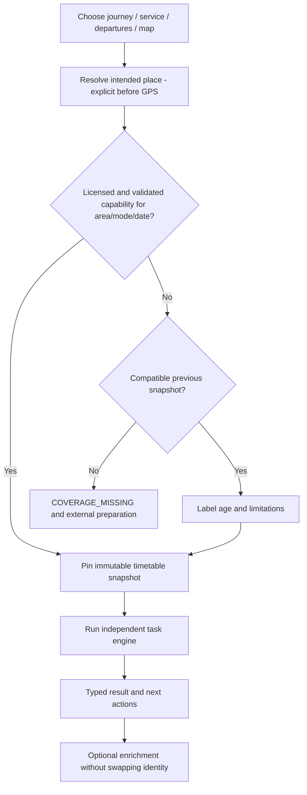
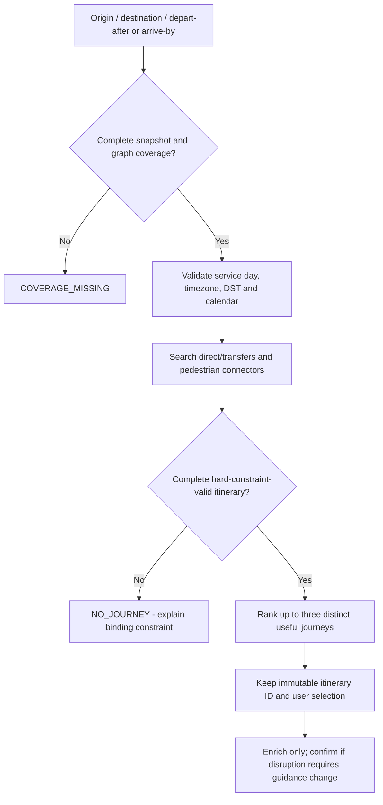
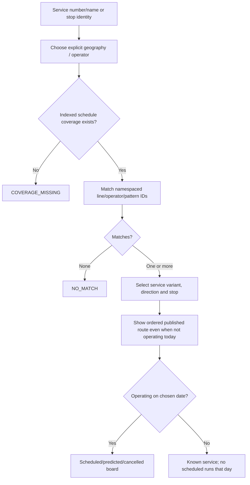
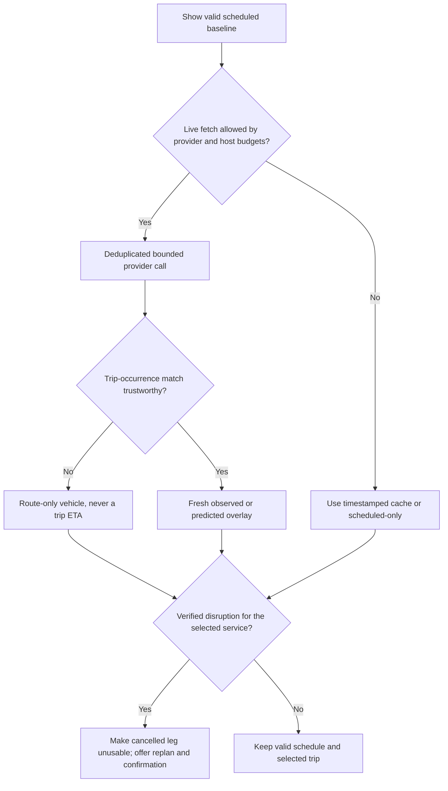
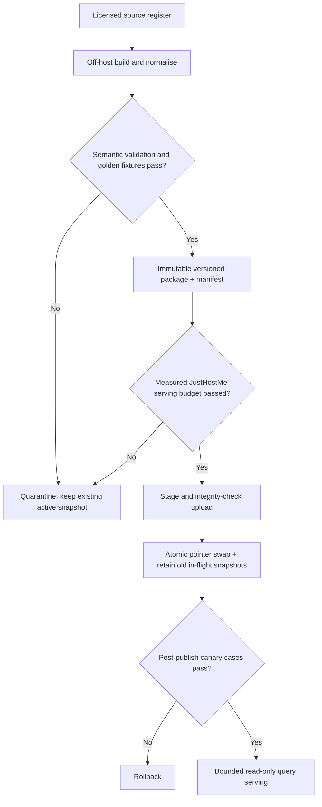
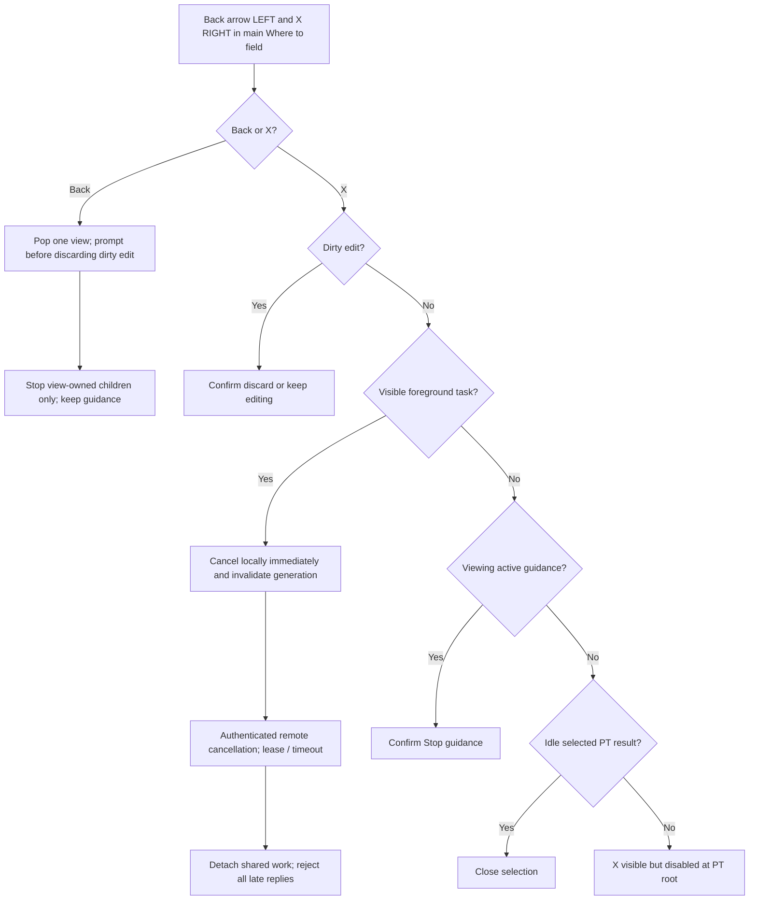
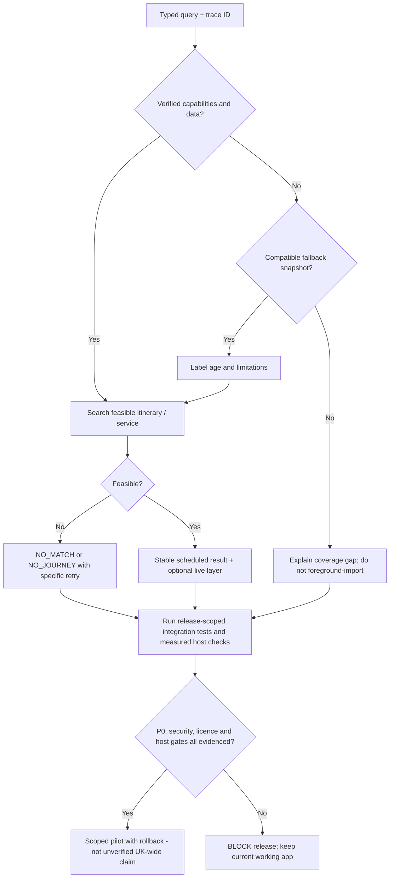

# Public Transport v2.2 - corrected core workflow diagrams

These Mermaid diagrams summarise the normative v2.2 contract. The downloadable design package contains the **full editable SVG and Graphviz versions**, 28-finding traceability register, complete v2.1 audit, and 105-row acceptance matrix. Earlier flowcharts are superseded where inconsistent.

## 01. Master and proven coverage

## 02. Feasible journeys

## 03. Services and departure boards

## 04. Live data

## 05. Data preparation and hosting

## 06. Persistent Back and X + cancellation

## 07. Recovery and scoped release gates

**Evidence disclaimer:** Green GitHub reference-test results do **not** mark Android/server end-to-end acceptance complete. All 105 production acceptance tests still require fixtures and real integration evidence.
